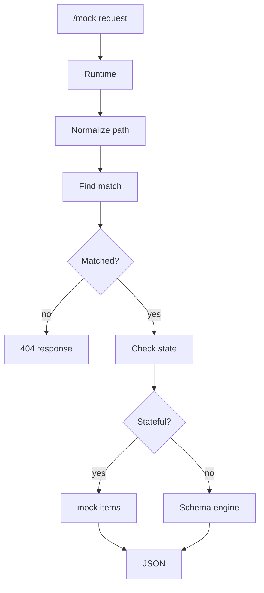

# mockAPI

mockAPI is a FastAPI application for creating mock HTTP endpoints, storing their
schemas, and serving simulated responses while a real backend is still being
designed or built.

It is meant for development workflows where frontend and backend work need to
move independently. A developer registers the contract that should exist, points
a client at mockAPI, and receives realistic JSON responses from `/mock`.

mockAPI is not a production API gateway or a replacement for a real backend. It
is a focused tool for prototyping, contract alignment, UI development, and
backend/frontend decoupling.

## Current Capabilities

The current app includes:

- FastAPI bootstrap with a central router in `app/routing.py`.
- SQLite persistence through SQLAlchemy.
- Database creation through `Base.metadata.create_all()` during app startup.
- An internal Jinja2 web UI under `/web`.
- A browser schema editor for objects and collections, plus an advanced JSON
  editor for definitions outside the visual controls.
- Admin APIs for registering and listing schemas and endpoints.
- A dynamic runtime under `/mock` that resolves registered endpoints.
- Schema-backed fake JSON generation using Faker.
- Semantic mock intentions such as `person.employee_name`, `finance.amount`, and
  `ops.case_title`.
- Optional stateful collection behavior persisted in the `mock_items` table.
- A sample Northstar Service Desk client under `examples/service_desk_client`.

## Quick Start

Install dependencies with `uv`:

```bash
uv sync
```

Run the app:

```bash
uv run uvicorn app.main:app --reload
```

Or install and run with `pip`:

```bash
pip install -r requirements.txt
uvicorn app.main:app --reload
```

Useful URLs:

```text
Web UI:          http://127.0.0.1:8000/web
Swagger/OpenAPI: http://127.0.0.1:8000/docs
Mock runtime:    http://127.0.0.1:8000/mock
```

## Main Workflow

The core workflow is:

1. Create a reusable schema through the UI or `POST /api/schemas`.
2. Register an endpoint with an HTTP method, path, and schema.
3. Call the endpoint through `/mock`.
4. mockAPI matches the request by method and normalized path.
5. The runtime returns either a stateful mock response or a generated response
   from the endpoint schema.

Stored endpoint paths do not include `/mock`.

For example, an endpoint stored as:

```json
{
  "method": "GET",
  "path": "/tickets"
}
```

is called by a client as:

```http
GET /mock/tickets
```

## Browser Schema Editor

The creation screen at `/web/create_endpoint_form` can build common response
definitions without writing JSON:

- Choose `Objeto individual` for a single object response.
- Choose `Colección de objetos` and set `Elementos iniciales` for a generated
  list that can drive stateful collection flows.
- Add fields and their type, mock intention, required marker, examples, enum
  values, or pattern through the visual controls.
- Use `Usar editor JSON avanzado` in the generated-contract panel for nested or
  otherwise unsupported structures.

Schemas created visually use the JSON-Schema-like `type`/`properties` format
shown below. Loaded definitions that cannot be represented visually remain
available through the advanced JSON editor rather than being flattened.

## Example Client

`examples/service_desk_client` contains **Northstar Service Desk**, a small
frontend that consumes mockAPI for tickets, assets, and vendors. It exercises
collection reads and CRUD-style mutations against the stateful mock layer.

Run mockAPI with an isolated demo database:

```bash
DB_NAME=mockapi_service_desk.db uv run uvicorn app.main:app --reload --port 8000
```

In another terminal, run the example client:

```bash
uv run uvicorn examples.service_desk_client.app:app --reload --port 8010
```

Then open `http://127.0.0.1:8010`. The main app allows the local example origins
`http://127.0.0.1:8010` and `http://localhost:8010` through CORS. Full endpoint
and schema setup instructions are in
`examples/service_desk_client/README.md`.

## Routes

### Web UI

| Route | Purpose |
| --- | --- |
| `/web/` | Dashboard summary. |
| `/web/endpoints` | List and inspect registered endpoints. |
| `/web/schemas` | List and inspect saved schemas. |
| `/web/create_endpoint_form` | Create schemas and endpoints from the browser. |

### Admin API

| Method | Route | Purpose |
| --- | --- | --- |
| `GET` | `/api/endpoints` | List registered endpoints. |
| `POST` | `/api/endpoints` | Register a mock endpoint. |
| `GET` | `/api/schemas` | List saved schemas. |
| `POST` | `/api/schemas` | Register a reusable schema. |
| `POST` | `/api/mock-state/reset` | Clear persisted mock state, globally or for one resource. |

### Runtime API

The runtime lives only under `/mock`:

```python
@router.api_route("", methods=MOCK_METHODS)
@router.api_route("/{path:path}", methods=MOCK_METHODS)
```

`MOCK_METHODS` currently includes:

```text
GET, POST, PUT, PATCH, DELETE, OPTIONS
```

If no endpoint matches a runtime request, mockAPI returns a `404` JSON response
with the requested method and normalized path.

## API Examples

### Create A Schema

```http
POST /api/schemas
Content-Type: application/json
```

```json
{
  "name": "Ticket list",
  "definition": {
    "type": "array",
    "minItems": 3,
    "items": {
      "type": "object",
      "properties": {
        "id": {"type": "string", "format": "uuid"},
        "title": {"type": "string", "x-mock": {"generator": "ops.case_title"}},
        "priority": {"type": "string", "enum": ["low", "normal", "high"]},
        "status": {"type": "string", "x-mock": {"generator": "workflow.status"}}
      }
    }
  }
}
```

### Register An Endpoint

An endpoint can reuse an existing schema:

```http
POST /api/endpoints
Content-Type: application/json
```

```json
{
  "name": "Tickets",
  "description": "Ticket collection for frontend development",
  "method": "GET",
  "path": "/tickets",
  "schema_id": 1
}
```

Or it can create an inline schema while registering the endpoint:

```json
{
  "name": "Login response",
  "method": "POST",
  "path": "/auth/login",
  "schema_name": "Login response",
  "schema": {
    "type": "object",
    "properties": {
      "token": {"type": "string", "example": "mock-session-token"},
      "email": {"type": "string", "format": "email"}
    }
  }
}
```

### Call The Mock Runtime

```http
GET /mock/tickets
```

For mutation-style resources, mockAPI can persist simple collection state when a
matching collection endpoint exists:

```http
POST /mock/tickets
Content-Type: application/json
```

```json
{
  "title": "Billing dashboard does not load",
  "priority": "high"
}
```

### Reset Mock State

Reset all persisted mock state:

```http
POST /api/mock-state/reset
```

Reset one resource:

```http
POST /api/mock-state/reset
Content-Type: application/json
```

```json
{
  "resource_path": "/tickets"
}
```

## Architecture

The preferred shape for application logic is:

```text
router -> service -> repository/storage
```

High-level responsibilities:

- `app/main.py` creates the FastAPI app, initializes the database during
  lifespan startup, mounts `/static`, includes routers, and redirects `/` to
  `/web`.
- `app/routing.py` registers web, admin, mock-state, schema, endpoint, and
  runtime routers.
- `app/api/` handles HTTP concerns: request parsing, dependencies, status codes,
  and response objects.
- `app/services/` contains application behavior: endpoint registration, schema
  registration, mock generation, semantic intentions, and stateful mock logic.
- `app/storage/` contains SQLAlchemy setup, models, and repositories.
- `app/web/` renders the internal UI with Jinja2.
- `app/ui/` contains templates, CSS, and browser-side JavaScript.

The runtime catch-all is intentionally scoped under `/mock`. There is no global
catch-all route at `/`, so `/docs`, `/openapi.json`, `/web`, `/static`, and
`/api` remain reserved for FastAPI, the UI, and admin surfaces.

## Runtime Flow



Path handling is normalized in two related places:

- Runtime requests use `normalize_path()` in `app/api/mock/runtime.py`.
- Stored endpoints use `normalize_endpoint_path()` in
  `app/storage/repositories/endpoint.py`.

The normalized form has a leading slash and no trailing slash unless the path is
root. For example, `tickets/` and `/tickets` both become `/tickets`.

Endpoint matching first tries an exact method/path match. The repository also
supports template-style path segments such as `/tickets/{ticket_id}` and returns
captured path params to the runtime.

## Schemas And Fake Data

Schemas are stored as JSON in `Schema.definition`.

The mock engine supports both a flat shape:

```json
{
  "name": {"type": "string"},
  "email": {"type": "string", "format": "email"}
}
```

and a JSON-Schema-like shape:

```json
{
  "type": "object",
  "properties": {
    "name": {"type": "string"},
    "email": {"type": "string", "format": "email"}
  }
}
```

When generating values, configured values take priority over inferred values:

1. `example`
2. `default`
3. `examples`
4. `enum`
5. `x-mock.pattern`
6. `x-mock.generator`
7. inferred generator from field names and context
8. type/format fallback

Supported schema hints include:

- `type`: `string`, `integer`, `number`, `boolean`, `array`, `object`
- `format`: examples include `email`, `uuid`, `date`, `date-time`, `url`
- `minimum`, `maximum`, `exclusiveMinimum`, `exclusiveMaximum`
- `minItems`
- `x-mock.count`
- `x-mock.generator`
- `x-mock.pattern`

Intentions are semantic generator keys. Examples:

```json
{
  "owner": {"type": "string", "x-mock": {"generator": "person.employee_name"}},
  "amount": {"type": "number", "x-mock": {"generator": "finance.amount"}},
  "title": {"type": "string", "x-mock": {"generator": "ops.case_title"}}
}
```

If no explicit generator is configured, mockAPI still tries to infer useful data
from field names, endpoint names, schema names, and parent fields.

## Stateful Mock Collections

For collection-like responses, mockAPI can persist generated items in the
`mock_items` table and then apply simple REST-style behavior.

Collection responses are detected when generated data is:

- a list, or
- a dictionary containing one of `items`, `tickets`, `data`, or `results`.

When stateful behavior applies:

- `GET /mock/resource` returns the persisted collection.
- `GET /mock/resource/{id}` returns one persisted item.
- `POST /mock/resource` creates an item.
- `PUT /mock/resource/{id}` replaces or creates an item.
- `PATCH /mock/resource/{id}` updates an item.
- `DELETE /mock/resource/{id}` deletes an item.

Query parameters other than `limit` and `offset` are treated as exact-match
filters against item fields. `limit` and `offset` are applied after filtering.

This stateful layer is intentionally small. It is useful for frontend workflows,
but it is not a full database, validation engine, or business-rules system.

## Database Notes

SQLite is the default database provider through `Settings.database_url`.

The default local database path is:

```text
app/mockapi.db
```

There is no Alembic setup yet. `init_db()` imports the model package and calls:

```python
Base.metadata.create_all(bind=engine)
```

If models change while a local SQLite database already exists, the current setup
does not migrate existing tables. In early development, deleting the local
database may be necessary after model changes.

Local database files, `.env` files, `__pycache__`, and other generated artifacts
should not be committed.

## Working With The Codebase

Use the existing layer boundaries when making changes:

- Keep HTTP-specific code in routers.
- Move application behavior into services when it grows beyond simple request
  handling.
- Keep SQLAlchemy queries and persistence operations in repositories.
- Keep the public mock runtime under `/mock`.
- Keep admin routes under `/api`.
- Register concrete routers before catch-all runtime routes.

Before relying on a local change, at least verify that the app imports:

```bash
PYTHONDONTWRITEBYTECODE=1 uv run python -c "from app.main import app; print(len(app.routes))"
```

There is currently no committed automated test suite or official lint/format
configuration.

## Current Limitations And TBDs

- Request bodies, query parameters, and path params are not validated against
  schemas before responding.
- Response scenarios and multiple status-code responses are not modeled yet.
- Request history and reporting are not implemented yet.
- Proxy mode is not implemented.
- There are no migrations; database schema changes rely on `create_all()`.
- There is no finalized quality stack for tests, formatting, linting, or type
  checking.
- The canonical schema format is still a product decision: flat schema,
  JSON-Schema-like definitions, or both.
- `HEAD` is not part of `MOCK_METHODS` yet.
