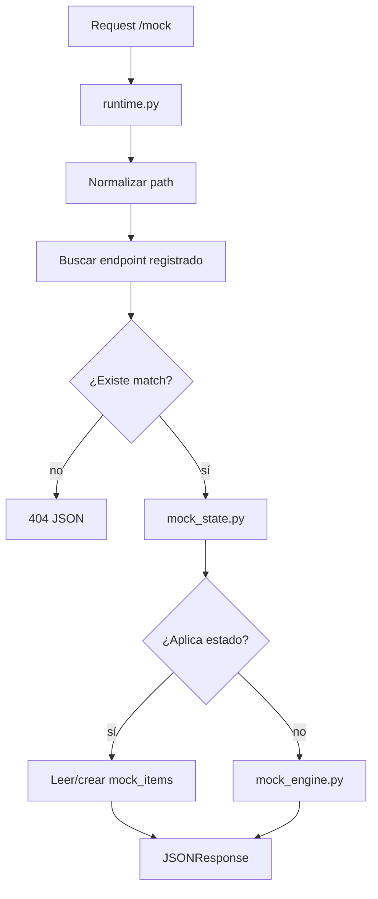

# Funcionamiento e implementación actual de mockAPI

Este documento describe cómo funciona actualmente la aplicación mockAPI y qué implementación existe en el repositorio. Está pensado como fuente factual para generar una presentación, un esquema inicial o una explicación técnica sin tener que volver a leer todo el código.

No describe aspiraciones como si ya estuvieran hechas. Cuando una capacidad no está implementada o solo aparece como idea futura, se indica explícitamente.

## 1. Qué es la aplicación

mockAPI es una aplicación backend en Python construida con FastAPI. Su objetivo es crear endpoints HTTP simulados, guardar sus schemas y responder peticiones bajo `/mock` con JSON generado automáticamente o con datos mock persistidos.

El caso de uso principal es desarrollo y prototipado: permite que un cliente, normalmente un frontend o una integración, consuma una API simulada mientras el backend real todavía no existe o sigue cambiando.

Según el README, mockAPI no está planteada como API gateway de producción ni como sustituto definitivo de un backend real.

## 2. Stack técnico actual

Tecnologías usadas y verificables en `pyproject.toml` y `requirements.txt`:

- Python `>=3.13`.
- FastAPI como framework web.
- Uvicorn como servidor ASGI.
- SQLAlchemy como ORM.
- SQLite como base de datos local por defecto.
- Pydantic Settings para configuración.
- Faker para generación de datos falsos.
- Jinja2 para la UI interna.
- JavaScript vanilla para formularios y preview JSON de la UI.

No hay dependencias de frontend tipo React, Vue o Angular. No hay Dockerfile ni `docker-compose.yml` en el repo.

## 3. Punto de entrada y arranque

El punto de entrada principal está en `app/main.py`.

Responsabilidades actuales:

- Crea la instancia `FastAPI`.
- Ejecuta `init_db()` durante el lifespan de arranque.
- Monta archivos estáticos en `/static`.
- Incluye el router central definido en `app/routing.py`.
- Redirige `/` hacia `/web` con status `302`.

Comando de arranque documentado:

```bash
uv run uvicorn app.main:app --reload
```

Comando de instalación/sincronización documentado:

```bash
uv sync
```

## 4. Configuración

La configuración vive en `app/core/settings.py`.

Valores principales:

- `app_name`: `"mockAPI"`.
- `db_name`: `"mockapi.db"`.
- `db_provider`: `"sqlite"`.
- `base_dir`: carpeta `app`.
- `templates_dir`: `app/ui/templates`.
- `static_dir`: `app/ui/static`.

La propiedad `database_url` construye la URL de SQLite así:

```text
sqlite:///app/mockapi.db
```

En `app/.env` existen variables locales como `APP_NAME`, `DB_DRIVER` y `DB_NAME`. Hay una diferencia importante: el código usa `db_provider`, pero el `.env` contiene `DB_DRIVER`, por lo que esa variable no cambia directamente el proveedor salvo que se ajuste el nombre.

La base local `app/mockapi.db` está ignorada por Git mediante `.gitignore`; no debe tratarse como fuente oficial de datos de demo.

## 5. Organización de carpetas

Estructura funcional del proyecto:

- `app/main.py`: entrada de la app FastAPI.
- `app/routing.py`: registra todos los routers públicos.
- `app/api/admin`: endpoints administrativos para schemas, endpoints y reset de estado.
- `app/api/mock`: runtime dinámico bajo `/mock`.
- `app/services`: lógica de aplicación.
- `app/storage`: conexión DB, modelos SQLAlchemy y repositorios.
- `app/web`: rutas HTML de la UI interna.
- `app/ui/templates`: plantillas Jinja2.
- `app/ui/static`: CSS y JavaScript de la UI.
- `docs`: documentación creada para presentación y explicación.

El README resume la arquitectura esperada como:

```text
router -> service -> repository/storage
```

El código sigue esa idea en la mayoría de los flujos principales.

## 6. Routers y rutas existentes

Los routers se agrupan en `app/routing.py`.

Rutas principales implementadas:

| Método | Ruta | Implementación | Propósito |
| --- | --- | --- | --- |
| `GET` | `/` | `app/main.py` | Redirige a `/web` |
| `GET` | `/web/` | `app/web/router.py` | Vista general HTML |
| `GET` | `/web/endpoints` | `app/web/router.py` | Lista endpoints registrados |
| `GET` | `/web/schemas` | `app/web/router.py` | Lista schemas guardados |
| `GET` | `/web/create_endpoint_form` | `app/web/router.py` | Formulario de creación |
| `GET` | `/api/endpoints` | `app/api/admin/endpoints.py` | Lista endpoints |
| `POST` | `/api/endpoints` | `app/api/admin/endpoints.py` | Registra endpoint mock |
| `GET` | `/api/schemas` | `app/api/admin/schemas.py` | Lista schemas |
| `POST` | `/api/schemas` | `app/api/admin/schemas.py` | Registra schema |
| `POST` | `/api/mock-state/reset` | `app/api/admin/mock_state.py` | Limpia estado mock persistido |
| `GET/POST/PUT/PATCH/DELETE/OPTIONS` | `/mock` y `/mock/{path:path}` | `app/api/mock/runtime.py` | Runtime dinámico |

FastAPI también expone automáticamente `/docs`, `/redoc` y `/openapi.json`.

`HEAD` no está incluido en `MOCK_METHODS`.

## 7. Modelo de datos actual

La persistencia usa SQLAlchemy y SQLite.

### Tabla `schemas`

Modelo: `app/storage/models/schema.py`

Campos:

- `id`: entero, primary key.
- `name`: string obligatorio.
- `definition`: JSON obligatorio.
- `created_at`: fecha de creación.

Relación:

- Un schema puede tener varios endpoints asociados.

### Tabla `endpoints`

Modelo: `app/storage/models/endpoint.py`

Campos:

- `id`: entero, primary key.
- `name`: string opcional.
- `description`: string opcional.
- `path`: string obligatorio.
- `method`: string obligatorio.
- `schema_id`: foreign key hacia `schemas.id`.

Relación:

- Cada endpoint pertenece a un schema.

Observación:

- No se ve una restricción única para `method + path`, así que podrían registrarse duplicados.

### Tabla `mock_items`

Modelo: `app/storage/models/mock_item.py`

Campos:

- `id`: entero, primary key.
- `resource_key`: string, identifica la colección mock, por ejemplo `/tickets`.
- `item_id`: string, identifica el item dentro de la colección.
- `data`: JSON con el contenido del item.
- `created_at`: fecha de creación.
- `updated_at`: fecha de actualización.

Restricción:

- Hay `UniqueConstraint("resource_key", "item_id")`.

Uso:

- Soporta comportamiento stateful para colecciones mock.

## 8. Inicialización y persistencia

La conexión DB está en `app/storage/database.py`.

Implementación actual:

- Crea un `engine` SQLAlchemy con `settings.database_url`.
- Usa `connect_args={"check_same_thread": False}` para SQLite.
- Define `SessionLocal`.
- Define `Base` como `DeclarativeBase`.
- `init_db()` importa `app.storage.models` para registrar modelos y llama a:

```python
Base.metadata.create_all(bind=engine)
```

Limitación:

- No hay Alembic ni migraciones. Si cambia el modelo, `create_all()` no migra tablas existentes.

## 9. Flujo principal de uso

El flujo principal de producto es:

1. Crear un schema reusable con `POST /api/schemas` o desde la UI.
2. Registrar un endpoint con `POST /api/endpoints`.
3. Consumir ese endpoint desde `/mock`.
4. El runtime busca una coincidencia por método y path.
5. Si la encuentra, devuelve JSON generado o estado mock persistido.
6. Si no la encuentra, devuelve error `404` en JSON.

Ejemplo conceptual:

Un endpoint guardado como:

```json
{
  "method": "GET",
  "path": "/tickets"
}
```

Se consume como:

```http
GET /mock/tickets
```

El path almacenado no incluye `/mock`.

## 10. Registro de schemas

Implementación:

- Router: `app/api/admin/schemas.py`.
- Servicio: `app/services/schema_registry.py`.
- Repositorio: `app/storage/repositories/schema.py`.
- Modelo: `app/storage/models/schema.py`.

Endpoint:

```http
POST /api/schemas
```

El router lee el JSON completo con `await request.json()` y llama a `register_schema()`.

`schema_payload()` acepta:

- `definition`
- o `schema`

Si no recibe nombre, usa `"Schema sin nombre"`.

El schema se guarda como JSON en la columna `definition`.

Endpoint de listado:

```http
GET /api/schemas
```

Devuelve una lista serializada con:

- `id`
- `name`
- `definition`
- `created_at`

## 11. Registro de endpoints

Implementación:

- Router: `app/api/admin/endpoints.py`.
- Servicio: `app/services/endpoint_registry.py`.
- Repositorio: `app/storage/repositories/endpoint.py`.
- Modelo: `app/storage/models/endpoint.py`.

Endpoint:

```http
POST /api/endpoints
```

El router lee el JSON completo con `await request.json()` y llama a `register_endpoint()`.

El endpoint puede usar:

- `schema_id`: reutiliza un schema existente si existe y se puede convertir a entero.
- `schema`: crea un schema inline si no hay `schema_id` válido.
- `schema_name`: nombre del schema inline.

Normalización:

- `method` se convierte a mayúsculas.
- `path` se asegura con `/` inicial.
- `path` elimina `/` final salvo que sea root.

Endpoint de listado:

```http
GET /api/endpoints
```

Devuelve una lista serializada con:

- `id`
- `name`
- `description`
- `method`
- `path`
- `schema_id`
- `schema_name`
- `schema`

## 12. Runtime dinámico `/mock`

Implementación principal: `app/api/mock/runtime.py`.

Métodos soportados:

```python
MOCK_METHODS = ["GET", "POST", "PUT", "PATCH", "DELETE", "OPTIONS"]
```

Rutas:

```python
@router.api_route("", methods=MOCK_METHODS)
@router.api_route("/{path:path}", methods=MOCK_METHODS)
```

Funcionamiento:

1. Recibe cualquier request bajo `/mock`.
2. Normaliza el path recibido con `normalize_path()`.
3. Lee payload JSON solo para `POST`, `PUT` y `PATCH`.
4. Busca endpoint registrado con `get_db_endpoint_match()`.
5. Si no hay match, responde `404`.
6. Si hay match, intenta `stateful_mock_response()`.
7. Si hay respuesta stateful, la devuelve con su status code.
8. Si no aplica stateful, genera respuesta con `mock_response_for_endpoint()`.

Error cuando no hay match:

```json
{
  "error": "No mock endpoint matched this request",
  "method": "GET",
  "path": "/missing"
}
```

## 13. Matching de endpoints

Implementación: `app/storage/repositories/endpoint.py`.

Funciones relevantes:

- `normalize_endpoint_method()`
- `normalize_endpoint_path()`
- `get_db_endpoint()`
- `get_db_endpoint_match()`
- `match_endpoint_template()`
- `template_path_param_names()`
- `path_last_param_name()`

Estrategia:

1. Primero busca coincidencia exacta por método y path.
2. Si no existe, busca endpoints del mismo método.
3. Ordena candidatos por especificidad.
4. Intenta hacer match con segmentos dinámicos tipo `{ticket_id}`.

Ejemplo soportado:

```text
/tickets/{ticket_id}
```

Puede coincidir con:

```text
/tickets/123
```

Y devuelve:

```json
{"ticket_id": "123"}
```

Limitación:

- No hay soporte para patrones regex dentro de params.
- El match se hace por número de segmentos y segmentos literales/paramétricos.

## 14. Motor de generación de respuestas

Implementación: `app/services/mock_engine.py`.

Entrada principal:

```python
mock_response_for_endpoint(endpoint)
```

El motor toma el schema asociado al endpoint y genera una respuesta JSON.

Soporta dos estilos de definición:

1. Schema plano:

```json
{
  "name": {"type": "string"},
  "email": {"type": "string", "format": "email"}
}
```

2. Forma similar a JSON Schema:

```json
{
  "type": "object",
  "properties": {
    "name": {"type": "string"},
    "email": {"type": "string", "format": "email"}
  }
}
```

Tipos soportados:

- `string`
- `integer`
- `number`
- `boolean`
- `array`
- `object`

Formatos y hints soportados:

- `format`: `email`, `uuid`, `date`, `date-time`, `url`, entre otros.
- `minimum`, `maximum`, `exclusiveMinimum`, `exclusiveMaximum`.
- `minItems`.
- `enum`.
- `example`.
- `default`.
- `examples`.
- `x-mock.count`.
- `x-mock.generator`.
- `x-mock.pattern`.

Prioridad de generación:

1. `example`
2. `default`
3. `examples`
4. `enum`
5. `x-mock.pattern`
6. `x-mock.generator`
7. inferencia por nombre/campo/contexto
8. fallback por tipo y formato

Tamaño de arrays:

- Por defecto: `3`.
- Puede cambiar con `minItems` o `x-mock.count`.

Limitación:

- El motor genera datos; no valida completamente JSON Schema.

## 15. Generadores semánticos

Implementación: `app/services/mock_intentions.py`.

Objetivo:

Generar valores más creíbles que simples palabras aleatorias.

El sistema usa:

- Generadores explícitos desde `x-mock.generator`.
- Inferencia desde nombre del campo, path, schema, endpoint y campos padre.

Ejemplos de generadores implementados:

- `ops.case_title`
- `ops.case_description`
- `ops.impact`
- `ops.note`
- `ops.queue`
- `ops.sla`
- `workflow.status`
- `workflow.priority`
- `finance.amount`
- `finance.currency`
- `finance.invoice_number`
- `finance.purchase_order`
- `company.name`
- `person.employee_name`
- `person.department`
- `person.team`
- `person.role`
- `asset.tag`
- `asset.hostname`
- `asset.serial`
- `asset.os`

Ejemplo de schema:

```json
{
  "title": {"type": "string", "x-mock": {"generator": "ops.case_title"}},
  "amount": {"type": "number", "x-mock": {"generator": "finance.amount"}},
  "owner": {"type": "string", "x-mock": {"generator": "person.employee_name"}}
}
```

Limitación:

- El catálogo de generadores es cerrado y vive en código.

## 16. Estado mock persistente

Implementación: `app/services/mock_state.py`.

Objetivo:

Permitir que ciertas colecciones mock se comporten como recursos REST simples.

La capa stateful se activa cuando la respuesta generada del endpoint de colección es:

- una lista;
- o un objeto con alguna clave de colección reconocida:
  - `items`
  - `tickets`
  - `data`
  - `results`

Métodos soportados cuando aplica stateful:

| Método | Ruta ejemplo | Comportamiento |
| --- | --- | --- |
| `GET` | `/mock/tickets` | Devuelve colección persistida |
| `GET` | `/mock/tickets/{id}` | Devuelve un item |
| `POST` | `/mock/tickets` | Crea un item |
| `PUT` | `/mock/tickets/{id}` | Reemplaza o crea un item |
| `PATCH` | `/mock/tickets/{id}` | Actualiza parcialmente un item |
| `DELETE` | `/mock/tickets/{id}` | Borra un item |

Cómo siembra datos:

1. Si no hay items persistidos para la colección, genera datos desde el endpoint de colección.
2. Normaliza cada item.
3. Asegura que cada item tenga id.
4. Guarda los items en `mock_items`.

Cómo elige campo id:

- Busca `id`, `_id` o `uuid` en el primer item generado.
- Si hay parámetro en path, puede usar ese nombre.
- Si no encuentra nada, usa `id`.

Filtros:

- Query params diferentes de `limit` y `offset` se tratan como filtros exactos por campo.
- `limit` y `offset` se aplican después del filtro.

Ejemplo:

```http
GET /mock/tickets?priority=high&limit=2
```

Limitaciones:

- No hay reglas de negocio.
- No hay validación contra schema.
- No es una base de datos de producción.
- La lógica está pensada para prototipos y demos.

## 17. Reset de estado

Implementación:

- Router: `app/api/admin/mock_state.py`.
- Servicio: `reset_mock_state()` en `app/services/mock_state.py`.
- Repositorio: `delete_mock_items()` en `app/storage/repositories/mock_item.py`.

Endpoint:

```http
POST /api/mock-state/reset
```

Sin body:

- Borra todos los registros de `mock_items`.

Con body:

```json
{
  "resource_path": "/tickets"
}
```

- Borra solo los items asociados a ese recurso.

También normaliza paths que empiecen por `/mock/`.

## 18. UI web actual

Implementación:

- Rutas HTML: `app/web/router.py`.
- Templates: `app/ui/templates`.
- JS: `app/ui/static/js`.
- CSS: `app/ui/static/css/app.css`.

Rutas:

- `/web/`: vista general.
- `/web/endpoints`: listado de endpoints.
- `/web/schemas`: listado de schemas.
- `/web/create_endpoint_form`: formulario para crear endpoint y schema.

Capacidades de la UI:

- Muestra contadores de endpoints, schemas y métodos.
- Lista endpoints guardados.
- Lista schemas guardados.
- Permite crear schemas desde formulario.
- Permite seleccionar schema existente.
- Genera preview JSON del payload que se enviará a `/api/endpoints`.
- Usa `fetch()` contra `/api/schemas` y `/api/endpoints`.

Limitación importante:

- La UI es útil para schemas simples o planos, pero no representa cómodamente todos los schemas complejos que el backend puede manejar, como arrays con objetos anidados en formato JSON-Schema-like.

## 19. Reportes y funcionalidades no implementadas

Existe `app/api/admin/reports.py`, pero solo contiene un comentario:

```python
# Should expose routes for usage, validation, and error reports.
```

Por tanto:

- No hay endpoints de reportes implementados.
- No hay historial de peticiones.
- No hay validación/reporting de errores de contrato.

Funcionalidades no implementadas actualmente:

- Validación de request body contra schema.
- Validación de query params contra schema.
- Validación de path params contra schema.
- Escenarios múltiples de respuesta.
- Status codes configurables por endpoint.
- Proxy hacia backend real.
- Autenticación/autorización.
- Migraciones de base de datos.
- Tests automatizados comprometidos.
- Dockerización.
- Frontend de negocio para usuarios finales.

## 20. Testing y verificación actual

No hay carpeta `tests` ni archivos `test_*.py` detectados en el repositorio.

El README indica que no hay suite automatizada ni configuración oficial de lint/format/type checking.

Verificación manual útil:

```bash
PYTHONDONTWRITEBYTECODE=1 uv run --no-sync python -c "from app.main import app; print(len(app.routes))"
```

Durante la inspección previa se verificó manualmente con `uvicorn` y una base SQLite temporal que funcionan:

- creación de schema;
- registro de endpoints;
- `GET /mock/tickets`;
- `POST /mock/tickets`;
- `GET /mock/tickets/{id}`;
- `PATCH /mock/tickets/{id}`;
- filtro por query params;
- respuesta `404` si no hay match;
- reset de estado mock.

Esta verificación no sustituye una suite de tests automatizados.

## 21. Flujo técnico completo de una petición `/mock`

Ejemplo:

```http
GET /mock/tickets
```

Paso a paso:

1. FastAPI dirige la petición a `receive_dynamic_request()` en `app/api/mock/runtime.py`.
2. `normalize_path()` convierte el path recibido en formato normalizado.
3. Como es `GET`, no se intenta leer body JSON.
4. `get_db_endpoint_match()` busca endpoint registrado para método `GET` y path `/tickets`.
5. Si no existe, devuelve `404`.
6. Si existe, `stateful_mock_response()` comprueba si aplica comportamiento persistente.
7. Si el endpoint representa una colección, revisa `mock_items`.
8. Si no hay items, genera items iniciales desde el schema.
9. Guarda los items en SQLite.
10. Devuelve la colección como JSON.
11. Si no aplica stateful, `mock_response_for_endpoint()` genera una respuesta stateless desde el schema.

Diagrama:



## 22. Ejemplo completo de demo técnica

Schema recomendado:

```json
{
  "name": "Tickets collection",
  "definition": {
    "type": "array",
    "minItems": 3,
    "items": {
      "type": "object",
      "properties": {
        "id": {"type": "string"},
        "title": {"type": "string", "x-mock": {"generator": "ops.case_title"}},
        "priority": {"type": "string", "enum": ["low", "normal", "high"]},
        "status": {"type": "string", "x-mock": {"generator": "workflow.status"}}
      }
    }
  }
}
```

Endpoints a registrar:

```json
{"name": "Tickets list", "method": "GET", "path": "/tickets", "schema_id": 1}
```

```json
{"name": "Create ticket", "method": "POST", "path": "/tickets", "schema_id": 1}
```

```json
{"name": "Ticket detail", "method": "GET", "path": "/tickets/{ticket_id}", "schema_id": 1}
```

```json
{"name": "Update ticket", "method": "PATCH", "path": "/tickets/{ticket_id}", "schema_id": 1}
```

Peticiones para enseñar:

```http
GET /mock/tickets
```

```http
POST /mock/tickets
Content-Type: application/json
```

```json
{
  "title": "Billing dashboard does not load",
  "priority": "high"
}
```

```http
PATCH /mock/tickets/{id}
Content-Type: application/json
```

```json
{
  "status": "closed"
}
```

```http
GET /mock/tickets?priority=high&limit=2
```

```http
POST /api/mock-state/reset
```

## 23. Cómo explicar el valor técnico

El valor técnico principal no está en crear una ruta fija, sino en combinar:

- Runtime dinámico bajo `/mock`.
- Registro persistente de endpoints.
- Registro persistente de schemas.
- Matching exacto y por templates.
- Generación automática de respuestas.
- Generadores semánticos orientados a datos realistas.
- Estado persistente opcional para colecciones.
- UI administrativa básica.
- Separación por capas.

Una forma clara de explicarlo:

"mockAPI convierte una configuración guardada en base de datos en una API simulada accesible por HTTP. El runtime no sabe de antemano qué endpoints existirán; los resuelve en tiempo de ejecución, busca el contrato asociado y genera o recupera una respuesta coherente."

## 24. Puntos fuertes actuales

- Arquitectura comprensible y separada por responsabilidades.
- Backend centrado en FastAPI, servicios y repositorios.
- Runtime dinámico bien acotado bajo `/mock`.
- Persistencia local suficiente para desarrollo.
- Generación de datos más rica que un mock estático.
- Estado mock persistente para demos CRUD simples.
- README completo y honesto sobre limitaciones.
- UI interna útil para enseñar el producto.

## 25. Limitaciones actuales importantes

- No hay suite de tests automatizados.
- No hay migraciones.
- No hay validación real de requests contra schemas.
- No hay autenticación.
- No hay roles ni permisos.
- No hay reporting ni historial.
- No hay proxy mode.
- No hay Docker.
- El schema format canónico todavía no está cerrado: el backend acepta forma plana y forma JSON-Schema-like.
- La UI no cubre todo lo que el backend soporta.
- `HEAD` no está soportado en `MOCK_METHODS`.

## 26. Archivos clave para enviar o mencionar

Para entender el proyecto:

- `README.md`
- `docs/PRESENTACION_PROYECTO.md`
- `docs/FUNCIONAMIENTO_E_IMPLEMENTACION.md`

Para entender el runtime:

- `app/api/mock/runtime.py`
- `app/storage/repositories/endpoint.py`

Para entender generación de datos:

- `app/services/mock_engine.py`
- `app/services/mock_intentions.py`

Para entender estado persistente:

- `app/services/mock_state.py`
- `app/storage/models/mock_item.py`
- `app/storage/repositories/mock_item.py`

Para entender persistencia:

- `app/storage/database.py`
- `app/storage/models/schema.py`
- `app/storage/models/endpoint.py`

Para entender API admin:

- `app/api/admin/schemas.py`
- `app/api/admin/endpoints.py`
- `app/api/admin/mock_state.py`

Para entender UI:

- `app/web/router.py`
- `app/ui/templates/*`
- `app/ui/static/js/*`

## 27. Resumen factual para otro ChatGPT

Usar esta síntesis si se quiere generar una presentación a partir de este documento:

mockAPI es una app FastAPI para registrar schemas y endpoints mock, persistirlos en SQLite y servir respuestas simuladas bajo `/mock`. Tiene una API administrativa para crear y listar schemas/endpoints, una UI interna con Jinja2 para gestionar recursos básicos, un runtime catch-all que resuelve endpoints por método/path, un motor de generación de datos con Faker y generadores semánticos, y una capa stateful que permite simular colecciones REST simples usando la tabla `mock_items`. Está bien orientada a desarrollo, prototipado y desacoplar frontend/backend. Actualmente no tiene tests automatizados, migraciones, autenticación, validación de requests contra schema, reportes ni proxy mode.
