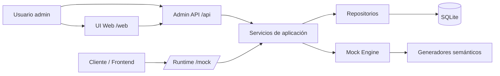
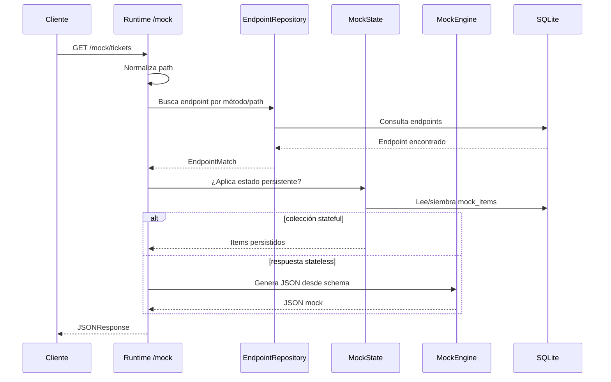
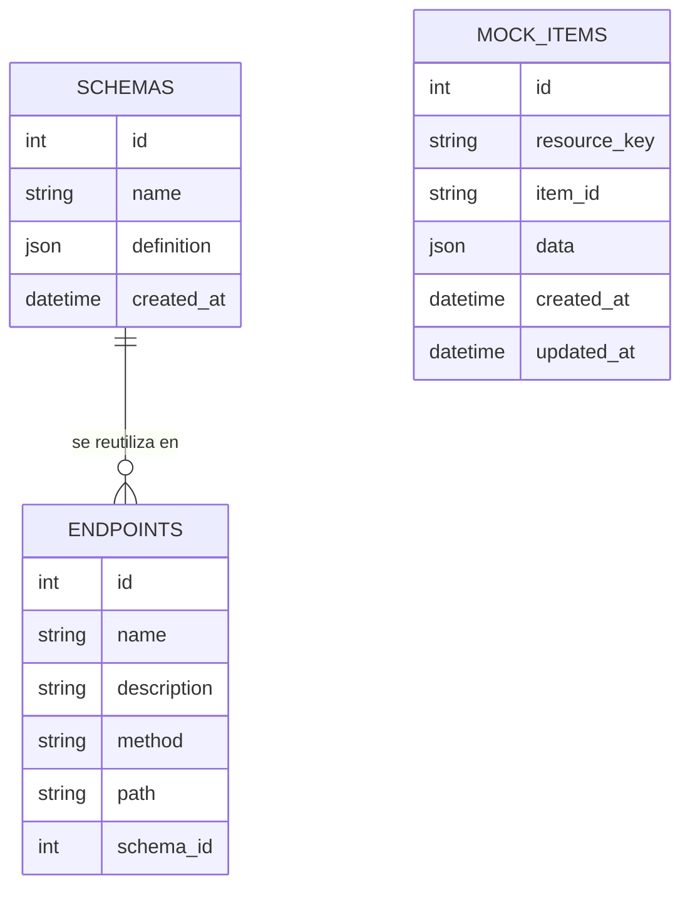

# Guía de presentación del proyecto

## 1. Resumen ejecutivo

mockAPI es una aplicación backend desarrollada con FastAPI que permite crear endpoints HTTP simulados, asociarlos a schemas JSON y servir respuestas realistas desde una ruta `/mock`. La idea principal es desbloquear el desarrollo frontend o la integración entre equipos cuando el backend real todavía no está terminado.

El problema que resuelve es la dependencia entre equipos: si una interfaz necesita consumir una API que aún no existe, mockAPI permite registrar el contrato esperado y empezar a trabajar con datos simulados pero coherentes.

- Nombre público: **mockAPI**. README, configuración y UI usan este nombre.
- Usuario objetivo: desarrolladores frontend, backend o equipos que necesitan prototipar contratos HTTP.
- Valor principal: simular APIs configurables con persistencia local y generación automática de respuestas.
- Tipo de producto: herramienta backend de desarrollo, no API gateway de producción.

## 2. Narrativa recomendada para la presentación

| Bloque | Objetivo | Qué enseñar | Qué decir oralmente | Qué evitar | Duración |
| --- | --- | --- | --- | --- | --- |
| 1. Apertura / contexto | Situar el proyecto | README y `/web` | "Este proyecto nace para evitar que frontend y backend se bloqueen entre sí." | Empezar hablando de frameworks sin explicar el problema | 1 min |
| 2. Problema | Hacer que el público entienda la necesidad | Flujo sin mockAPI | "Sin una API disponible, los equipos acaban usando JSON estático, mocks manuales o esperando al backend real." | Explicar genéricamente qué es una API | 1-2 min |
| 3. Solución | Presentar la idea | `/api/schemas`, `/api/endpoints`, `/mock` | "Registras un contrato, lo guardas, y luego cualquier cliente llama a `/mock` como si fuera la API real." | Prometer validación completa de contratos | 2 min |
| 4. Demo funcional | Demostrar valor real | Crear schema, registrar endpoints, llamar `/mock/tickets` | "Ahora voy a simular una API de tickets con datos persistentes." | Usar datos no preparados o depender solo de la UI para schemas complejos | 5-7 min |
| 5. Arquitectura | Justificar diseño | Diagrama router -> service -> repository | "Separé HTTP, lógica de negocio y persistencia para que el runtime no esté mezclado con SQL o plantillas." | Leer todos los archivos línea a línea | 4 min |
| 6. Backend | Enseñar lo más valioso | `runtime.py`, `mock_engine.py`, `mock_state.py` | "El valor técnico está en el matching dinámico, la generación semántica y el estado mock persistente." | Centrarse demasiado en HTML/CSS | 5 min |
| 7. Funcionalidades implementadas | Aterrizar alcance | Tabla de endpoints y capacidades | "Esto está implementado y comprobado; esto otro queda como evolución." | Decir que valida requests si no lo hace | 2 min |
| 8. Estructura del proyecto | Mostrar mantenibilidad | Carpetas `api`, `services`, `storage`, `web`, `ui` | "La estructura sigue responsabilidades claras." | Mostrar árbol completo de `.venv` o `__pycache__` | 2 min |
| 9. Decisiones técnicas | Defender elecciones | FastAPI, SQLite, SQLAlchemy, Jinja2, Faker | "Son decisiones simples y adecuadas para una herramienta local de desarrollo." | Vender SQLite como solución enterprise | 3 min |
| 10. Limitaciones | Generar confianza | README "Current limitations" | "No lo presento como producto terminado; es un MVP backend sólido con límites claros." | Ocultar ausencia de tests | 2 min |
| 11. Próximas implementaciones | Mostrar visión | Validación, escenarios, tests, reportes | "Las siguientes mejoras salen directamente de lo que ya existe." | Fantasear con IA, cloud o features no conectadas | 2 min |
| 12. Cierre | Resumir valor | Diagrama final + demo funcionando | "mockAPI convierte contratos de API en endpoints simulados útiles para desarrollo real." | Cerrar solo con detalles técnicos | 1 min |

## 3. Problema que resuelve la app

El problema concreto es que muchas interfaces o clientes necesitan consumir endpoints antes de que el backend real esté terminado. Sin una herramienta como esta, el equipo suele depender de JSON estático, mocks dispersos en el frontend, Postman manual, respuestas copiadas a mano o esperas entre equipos.

El usuario que más sufre este problema es un desarrollador que necesita avanzar con pantallas, flujos de integración o pruebas de contrato sin tener todavía una API real estable.

Tareas que se vuelven lentas o frágiles sin mockAPI:

- Crear datos falsos manualmente para cada pantalla.
- Mantener mocks en varios sitios del proyecto frontend.
- Cambiar contratos a mano cuando cambia un endpoint.
- Simular creación, edición o borrado de recursos.
- Probar estados de UI sin depender de un backend real.

Tiene sentido crear esta solución porque centraliza los mocks en un backend local, con endpoints HTTP reales, schemas guardados y datos generados automáticamente.

## 4. Solución propuesta

mockAPI propone registrar endpoints simulados y schemas reutilizables desde una API administrativa o una UI interna. Después, el cliente consume esos endpoints bajo `/mock`.

Flujo principal:

1. Se crea un schema JSON.
2. Se registra un endpoint con método HTTP, path y schema.
3. El cliente llama a `/mock/...`.
4. El runtime normaliza el path y busca un endpoint registrado.
5. Si hay coincidencia, devuelve una respuesta generada desde el schema o una respuesta con estado persistente.
6. Si no hay coincidencia, devuelve un `404` JSON explicativo.

Componentes implicados:

- API admin: registra schemas y endpoints.
- Runtime `/mock`: recibe llamadas dinámicas.
- Motor de generación: transforma schemas en JSON falso.
- Estado mock: persiste colecciones simples en SQLite.
- Repositorios: encapsulan consultas SQLAlchemy.
- UI web: permite listar y crear recursos desde navegador.

Qué recibe la app:

- Definiciones de schema.
- Configuración de endpoint: método, path, nombre, descripción.
- Peticiones HTTP contra `/mock`.
- Payloads JSON para operaciones `POST`, `PUT` y `PATCH`.

Qué devuelve:

- JSON generado.
- Colecciones persistidas.
- Errores JSON cuando no hay endpoint registrado.
- Listados administrativos de schemas y endpoints.

## 5. Demo recomendada paso a paso

### Demo principal: API mock de tickets

Escenario: un equipo frontend necesita desarrollar una pantalla de tickets de soporte antes de que exista el backend real.

Datos recomendados:

- Recurso: `/tickets`.
- Métodos: `GET`, `POST`, `GET /tickets/{ticket_id}`, `PATCH /tickets/{ticket_id}`, `DELETE /tickets/{ticket_id}`.
- Campos: `id`, `title`, `priority`, `status`.
- Generadores útiles: `ops.case_title`, `workflow.status`.
- Enum: `priority` con `low`, `normal`, `high`.

Arranque:

```bash
uv sync
uv run uvicorn app.main:app --reload
```

URLs preparadas:

- `http://127.0.0.1:8000/web`
- `http://127.0.0.1:8000/docs`
- `http://127.0.0.1:8000/mock/tickets`

Paso 1: crear schema por API o Swagger.

```http
POST /api/schemas
```

Body recomendado:

```json
{
  "name": "Tickets collection",
  "definition": {
    "type": "array",
    "minItems": 3,
    "items": {
      "type": "object",
      "properties": {
        "id": {"type": "string"},
        "title": {"type": "string", "x-mock": {"generator": "ops.case_title"}},
        "priority": {"type": "string", "enum": ["low", "normal", "high"]},
        "status": {"type": "string", "x-mock": {"generator": "workflow.status"}}
      }
    }
  }
}
```

Qué explicar: "El schema define la forma de la respuesta y también pistas para generar datos realistas."

Paso 2: registrar endpoints.

```http
POST /api/endpoints
```

Registrar al menos:

```json
{"name": "Tickets list", "method": "GET", "path": "/tickets", "schema_id": 1}
```

```json
{"name": "Create ticket", "method": "POST", "path": "/tickets", "schema_id": 1}
```

```json
{"name": "Ticket detail", "method": "GET", "path": "/tickets/{ticket_id}", "schema_id": 1}
```

```json
{"name": "Update ticket", "method": "PATCH", "path": "/tickets/{ticket_id}", "schema_id": 1}
```

Qué explicar: "El path guardado no incluye `/mock`; `/mock` es la puerta de entrada del runtime."

Paso 3: consumir la API mock.

```http
GET /mock/tickets
```

Resultado esperado: lista JSON con tickets generados y persistidos.

Paso 4: crear un ticket.

```http
POST /mock/tickets
Content-Type: application/json
```

```json
{
  "title": "Billing dashboard does not load",
  "priority": "high"
}
```

Resultado esperado: `201` con el item creado, id asignado y campos generados/completados.

Paso 5: consultar y actualizar item.

```http
GET /mock/tickets/{id}
PATCH /mock/tickets/{id}
```

Payload para patch:

```json
{"status": "closed"}
```

Resultado esperado: el ticket mantiene su estado actualizado en SQLite.

Paso 6: filtrar colección.

```http
GET /mock/tickets?priority=high&limit=2
```

Resultado esperado: colección filtrada por coincidencia exacta y limitada.

Qué puede fallar:

- Si no se registra el endpoint `POST /tickets`, `POST /mock/tickets` devuelve 404.
- Si no se registra `GET /tickets/{ticket_id}`, la consulta por id no entra al flujo stateful.
- Si el schema no genera una lista o una clave tipo `items`, `tickets`, `data` o `results`, no se activa la colección persistente.
- Si la base local tiene datos antiguos, la demo puede mostrar resultados inesperados.

Mitigación:

- Usar una base temporal para ensayar: `DB_NAME=/tmp/mockapi_demo.db uv run uvicorn app.main:app --reload`.
- Ejecutar antes `POST /api/mock-state/reset`.
- Tener preparados los JSON en un archivo o en Swagger.
- No depender solo de la UI para el schema de colección, porque la UI es más cómoda para schemas planos.

Alternativa si falla la demo en vivo:

- Mostrar `/web/endpoints` y `/web/schemas`.
- Mostrar los cuerpos JSON ya preparados.
- Ejecutar solo `GET /mock/missing` para enseñar el runtime y luego explicar el flujo con el diagrama.
- Enseñar una captura o salida guardada de `GET /mock/tickets`.

### Caso secundario 1: endpoint simple de login

Funcionalidad soportada: endpoint stateless con schema inline.

Registrar:

```json
{
  "name": "Login response",
  "method": "POST",
  "path": "/auth/login",
  "schema_name": "Login response",
  "schema": {
    "type": "object",
    "properties": {
      "token": {"type": "string", "example": "mock-session-token"},
      "email": {"type": "string", "format": "email"}
    }
  }
}
```

Demostrar:

```http
POST /mock/auth/login
```

Valor: muestra que mockAPI no solo sirve listas; también puede simular respuestas de autenticación o endpoints concretos.

### Caso secundario 2: endpoint no encontrado

Demostrar:

```http
GET /mock/no-existe
```

Resultado esperado:

```json
{
  "error": "No mock endpoint matched this request",
  "method": "GET",
  "path": "/no-existe"
}
```

Valor: muestra manejo básico de errores y normalización del path.

### Caso secundario 3: UI web administrativa

Demostrar:

- `/web/`: vista general.
- `/web/endpoints`: endpoints registrados.
- `/web/schemas`: schemas guardados.
- `/web/create_endpoint_form`: formulario de creación.

Valor: enseña que no todo depende de curl o Swagger, aunque el valor principal sigue estando en backend.

### Demo técnica: recorrido por el backend

Abrir en el editor:

- `app/api/mock/runtime.py`
- `app/services/mock_engine.py`
- `app/services/mock_state.py`
- `app/storage/repositories/endpoint.py`
- `app/storage/models/*.py`

Explicar:

1. El runtime recibe cualquier método soportado bajo `/mock`.
2. El repositorio busca coincidencia exacta o por template.
3. La capa stateful decide si hay colección persistente.
4. Si no aplica estado, el motor genera JSON desde el schema.
5. SQLAlchemy guarda schemas, endpoints y mock items.

## 6. Funcionalidades implementadas

| Estado | Funcionalidad | Explicación no experta | Explicación técnica | Dónde está | Cómo demostrarla | Valor |
| --- | --- | --- | --- | --- | --- | --- |
| COMPLETA | Registro de schemas | Guardar plantillas de respuesta | `POST /api/schemas`, modelo `Schema` con JSON | `app/api/admin/schemas.py`, `app/services/schema_registry.py`, `app/storage/models/schema.py` | Crear schema y verlo en `/web/schemas` | Reutilización |
| COMPLETA | Registro de endpoints | Definir qué rutas simuladas existen | `POST /api/endpoints`, relación con schema | `app/api/admin/endpoints.py`, `endpoint_registry.py`, `Endpoint` | Registrar `/tickets` | Contrato HTTP configurable |
| COMPLETA | Runtime `/mock` | Consumir endpoints simulados | Catch-all bajo `/mock` con métodos configurados | `app/api/mock/runtime.py` | `GET /mock/tickets` | Simulación real por HTTP |
| COMPLETA | Matching por método y path | Encontrar endpoint correcto | Exact match y templates como `/tickets/{ticket_id}` | `app/storage/repositories/endpoint.py` | `GET /mock/tickets/{id}` | Flexibilidad de rutas |
| COMPLETA | Generación de JSON desde schema | Crear datos falsos automáticamente | Soporta tipos, formatos, enum, examples, default, arrays, objects | `app/services/mock_engine.py` | Crear schema con `email`, `uuid`, `enum` | Reduce mocks manuales |
| COMPLETA | Generadores semánticos | Datos más creíbles por contexto | `x-mock.generator` e inferencia por tokens | `app/services/mock_intentions.py` | `ops.case_title`, `finance.amount` | Datos presentables |
| COMPLETA | Estado persistente de colecciones | Crear/editar/borrar recursos mock | Tabla `mock_items`, lógica REST simple | `app/services/mock_state.py`, `mock_item.py` | `POST`, `PATCH`, `DELETE /mock/tickets/{id}` | Demo más realista |
| COMPLETA | Filtros simples | Buscar items por query params | Filtro exacto por campos; `limit` y `offset` | `mock_state.py` | `/mock/tickets?priority=high&limit=2` | Útil para UI |
| COMPLETA | Reset de estado | Limpiar datos mock | `POST /api/mock-state/reset` | `app/api/admin/mock_state.py` | Reset global o por recurso | Repetir demos |
| PARCIAL | UI web | Gestionar desde navegador | Jinja2 + JS que llama a `/api` | `app/web/router.py`, `app/ui/*` | Crear endpoint simple y listar | Buena para enseñar, limitada para schemas complejos |
| SOPORTE INTERNO | Configuración | Centralizar rutas y DB | `pydantic-settings`, SQLite por defecto | `app/core/settings.py` | Mostrar `database_url` | Orden técnico |
| SOPORTE INTERNO | Persistencia SQLAlchemy | Guardar datos localmente | Modelos y repositorios | `app/storage/*` | Ver tablas conceptuales | Separación de capas |
| NO DEMOSTRAR salvo que sea necesario | Reportes | Hay intención de reportes, pero no feature | Solo comentario stub | `app/api/admin/reports.py` | No demostrar | No está implementado |

Cosas no implementadas:

- Validación de request bodies, query parameters o path params contra schemas.
- Múltiples escenarios de respuesta por endpoint.
- Múltiples status codes configurables por endpoint.
- Proxy hacia backend real.
- Historial de peticiones o reporting.
- Autenticación/autorización.
- Migraciones con Alembic.
- Suite automatizada de tests.
- Cliente frontend de negocio; existe solo UI administrativa.

## 7. Arquitectura del sistema

Arquitectura general:



Flujo típico de petición runtime:



Modelo conceptual de datos:



Responsabilidades principales:

- `app/main.py`: crea la app FastAPI, inicializa DB en lifespan, monta estáticos y redirige `/` a `/web`.
- `app/routing.py`: registra routers públicos.
- `app/api`: capa HTTP.
- `app/services`: lógica de aplicación.
- `app/storage`: SQLAlchemy, modelos y repositorios.
- `app/web` y `app/ui`: UI interna.

Validaciones y errores:

- El runtime devuelve `404` JSON si no hay endpoint.
- Operaciones stateful sobre item inexistente devuelven `404`.
- La normalización evita diferencias entre `/tickets` y `/tickets/`.
- No hay validación fuerte de payloads administrativos con Pydantic.
- No se validan requests contra schemas.

## 8. Estructura del proyecto

Entrada de aplicación:

- `app/main.py`: instancia FastAPI, startup DB, static files y redirect.
- `app/routing.py`: composición de routers.

API/rutas:

- `app/api/admin/endpoints.py`: `GET` y `POST /api/endpoints`.
- `app/api/admin/schemas.py`: `GET` y `POST /api/schemas`.
- `app/api/admin/mock_state.py`: `POST /api/mock-state/reset`.
- `app/api/mock/runtime.py`: catch-all `/mock`.

Lógica de negocio:

- `app/services/endpoint_registry.py`: construcción, normalización y serialización de endpoints.
- `app/services/schema_registry.py`: registro y listado de schemas.
- `app/services/mock_engine.py`: generación de respuestas.
- `app/services/mock_intentions.py`: generadores semánticos.
- `app/services/mock_state.py`: comportamiento stateful.

Persistencia:

- `app/storage/database.py`: engine, sesiones e `init_db()`.
- `app/storage/models/schema.py`: tabla `schemas`.
- `app/storage/models/endpoint.py`: tabla `endpoints`.
- `app/storage/models/mock_item.py`: tabla `mock_items`.
- `app/storage/repositories/*.py`: consultas y escrituras.

Configuración:

- `app/core/settings.py`: paths, nombre de app, proveedor DB y URL SQLite.
- `pyproject.toml` y `requirements.txt`: dependencias.
- `app/.env`: configuración local; `DB_DRIVER` no coincide con el campo `db_provider`.

UI:

- `app/web/router.py`: rutas HTML.
- `app/ui/templates/*`: Jinja2.
- `app/ui/static/js/*`: formularios, preview JSON, carga de schemas.
- `app/ui/static/css/app.css`: estilos.

Tests:

- No hay carpeta `tests` ni archivos `test_*.py` detectados.

Documentación:

- `README.md`: muy útil; describe capacidades, arquitectura, ejemplos, límites y quick start.

## 9. Componentes técnicos destacados

### Runtime dinámico `/mock`

Resuelve el problema de servir cualquier endpoint simulado sin crear una ruta FastAPI por cada mock. Usa `@router.api_route` para aceptar varios métodos y path dinámico.

Ventaja: el producto puede crecer registrando datos en DB, no escribiendo rutas nuevas.

Limitación: depende de que el endpoint esté registrado previamente; si falta el método exacto, devuelve 404.

### Matching de endpoints

Primero busca coincidencia exacta por método/path. Después soporta templates como `/tickets/{ticket_id}`.

Ventaja: permite recursos tipo REST y operaciones sobre items.

Limitación: no hay restricción única visible para método/path, así que endpoints duplicados podrían generar comportamiento confuso.

### Motor de generación de respuestas

Convierte schemas en datos JSON. Prioriza `example`, `default`, `examples`, `enum`, patrón, generador explícito, inferencia semántica y fallback por tipo/formato.

Ventaja: permite respuestas útiles sin escribir JSON a mano.

Limitación: no es un validador JSON Schema completo.

### Generadores semánticos

`mock_intentions.py` contiene generadores para dominios como operaciones, finanzas, activos, personas y workflow.

Ventaja: los datos tienen más sentido en una demo que simples strings aleatorios.

Limitación: el catálogo es cerrado y se amplía por código.

### Estado persistente de colecciones

Detecta colecciones cuando la respuesta generada es una lista o un objeto con claves `items`, `tickets`, `data` o `results`. Guarda items en `mock_items`.

Ventaja: permite demostrar flujos de creación, actualización, borrado y filtros.

Limitación: no es una base de negocio completa; no aplica reglas de dominio ni validación de payload.

### Separación router -> service -> repository

El README lo declara como forma preferida y el código lo sigue en las rutas principales.

Ventaja: facilita explicar arquitectura limpia sin sobredimensionarla.

Limitación: algunos endpoints administrativos parsean `Request` directamente y no tienen DTOs Pydantic.

## 10. Decisiones técnicas importantes

| Decisión | Qué se eligió | Por qué tiene sentido | Alternativa | Trade-off |
| --- | --- | --- | --- | --- |
| Framework | FastAPI | Rápido para APIs, docs automáticas, async-compatible | Flask, Django REST | Menos estructura opinionada que Django |
| Persistencia | SQLite + SQLAlchemy | Sencillo, local, suficiente para herramienta de desarrollo | PostgreSQL | No ideal para producción multiusuario |
| Inicialización DB | `Base.metadata.create_all()` | Arranque simple para MVP | Alembic | Sin migraciones reales |
| Capas | Router -> service -> repository | Código más explicable y mantenible | Lógica en routers | Más archivos, pero mejor separación |
| Runtime | Catch-all limitado a `/mock` | No bloquea `/api`, `/web`, `/docs` | Catch-all global | Más seguro y claro |
| Schemas | JSON en DB | Flexible para contratos variados | Tablas normalizadas | Menos validación estructural |
| Datos falsos | Faker + generadores propios | Realismo sin servicio externo | Datos estáticos | Resultados no deterministas |
| UI | Jinja2 + JS simple | Suficiente para admin interna | SPA frontend | Menos complejidad |
| Config | `pydantic-settings` | Centraliza paths/env | Constantes sueltas | Algunas vars actuales no están alineadas |
| Validación | Mínima en routers | Avanza rápido en MVP | Pydantic models completos | Menos robustez ante entradas inválidas |

## 11. Testing y calidad

No hay suite automatizada comprometida en el repositorio. No se detectaron archivos `test_*.py` ni carpeta `tests`.

Verificaciones útiles para la presentación:

```bash
uv sync
PYTHONDONTWRITEBYTECODE=1 uv run --no-sync python -c "from app.main import app; print(len(app.routes))"
```

Comando de arranque:

```bash
uv run uvicorn app.main:app --reload
```

Qué se puede decir sin quedar mal:

"Ahora mismo el proyecto está en fase MVP. La funcionalidad principal está estructurada y se puede validar con smoke tests manuales, pero una mejora prioritaria es añadir una suite automatizada con pytest para runtime, motor de schemas, matching y estado persistente."

Qué conviene enseñar:

- Import correcto de la app.
- Listado de rutas FastAPI.
- Demo manual con base temporal.
- README donde se reconocen limitaciones.

Qué no está cubierto:

- Matching de rutas.
- Generación por schema.
- Operaciones stateful.
- Errores.
- UI.
- Persistencia.
- Configuración.

## 12. Guion oral sugerido

Introducción:

"Mi proyecto se llama mockAPI. Es una herramienta backend pensada para equipos que necesitan consumir una API antes de que el backend real esté terminado. En vez de tener mocks desperdigados en el frontend, aquí registramos endpoints y schemas en una aplicación FastAPI y luego consumimos respuestas desde `/mock`."

Problema:

"El caso típico es un frontend que necesita avanzar con una pantalla de tickets, login o panel operativo, pero la API todavía está en diseño. Eso provoca esperas, JSON copiado a mano y contratos poco claros."

Solución:

"mockAPI centraliza ese contrato. Primero registro un schema, luego registro un endpoint con método y path, y finalmente cualquier cliente puede llamar a `/mock/tickets` como si fuera una API real."

Demo:

"Voy a crear una API simulada de tickets. El schema define los campos y algunas intenciones semánticas para que los datos parezcan tickets reales. Después registraré endpoints de lista, creación y actualización. Lo importante es que no solo devuelve JSON aleatorio: también puede mantener estado en SQLite."

Arquitectura:

"La arquitectura está separada por capas. Los routers manejan HTTP, los services contienen la lógica de aplicación y los repositories encapsulan SQLAlchemy. El runtime dinámico vive solo bajo `/mock`, así que no interfiere con `/api`, `/web` o `/docs`."

Cierre:

"El valor del proyecto es que convierte contratos de API en endpoints simulados útiles para desarrollar y validar interfaces. No pretende sustituir un backend real, pero sí reducir bloqueos y mejorar la coordinación entre frontend y backend."

## 13. Posibles diapositivas

| Slide | Título | Objetivo | Bullets | Visual | Qué decir | Qué no meter |
| --- | --- | --- | --- | --- | --- | --- |
| 1 | mockAPI | Presentar producto | API mock, schemas, `/mock`, desarrollo desacoplado | Logo simple + flujo | "Herramienta para simular APIs reales" | Lista de dependencias |
| 2 | Problema | Justificar necesidad | Backend no listo, mocks manuales, contratos frágiles | Antes/después | "El bloqueo entre equipos es el problema" | Definición larga de API |
| 3 | Solución | Explicar propuesta | Crear schema, registrar endpoint, consumir mock | Diagrama 3 pasos | "Registro una vez, consumo muchas" | Código interno |
| 4 | Demo | Preparar lo que se verá | Tickets, GET/POST/PATCH, filtros | Tabla endpoint | "Vamos a simular una API de tickets" | Demasiados endpoints |
| 5 | Arquitectura | Vender backend | FastAPI, services, repositories, SQLite | Mermaid general | "Cada capa tiene responsabilidad" | Árbol completo |
| 6 | Runtime | Enseñar núcleo | `/mock`, matching, 404 JSON | Flujo petición | "El runtime resuelve dinámicamente" | Detalles de CSS |
| 7 | Mock Engine | Mostrar valor técnico | Faker, schema, x-mock, inferencia | Prioridad de generación | "No son datos estáticos" | Toda la lista de generadores |
| 8 | Estado Mock | Enseñar CRUD simulado | `mock_items`, seed, filtros | Modelo datos | "Permite demos con persistencia" | Prometer DB completa |
| 9 | Límites | Ganar credibilidad | No tests, no validación request, no proxy | Checklist honesta | "Sé qué falta" | Excusas |
| 10 | Evolución | Cerrar con futuro | Tests, validación, escenarios, reportes | Roadmap simple | "La evolución encaja con la base actual" | Features fantasiosas |

## 14. Próximas implementaciones razonables

| Mejora | Qué sería | Valor | Dificultad | Parte afectada | Prioridad |
| --- | --- | --- | --- | --- | --- |
| Suite de tests | Tests para runtime, engine, state y repos | Da confianza técnica | Media | `tests`, dependencias dev | Alta |
| Validación de requests | Comprobar payload/query contra schemas | Evita mocks demasiado permisivos | Alta | `runtime`, schemas, errores | Alta |
| Escenarios de respuesta | Configurar varias respuestas/status por endpoint | Simula errores, loading, estados alternativos | Media | modelos, services, UI | Alta |
| Migraciones | Alembic o estrategia de migración | Evoluciona DB sin borrar datos | Media | `storage` | Media |
| Reportes/historial | Guardar llamadas recibidas | Ayuda a depurar integraciones | Media | nuevo modelo + API reports | Media |
| Mejor UI de schemas complejos | Crear arrays/objects anidados desde navegador | Hace demos sin curl | Media/alta | `schema_form.js`, templates | Media |
| Validación administrativa | Pydantic models para `/api` | Mejora errores y OpenAPI | Media | `api/admin`, schemas DTO | Alta |
| Docker | Arranque reproducible | Facilita presentación y entrega | Baja/media | Dockerfile/compose | Media |
| Autenticación básica | Proteger admin API/UI | Evita exposición accidental | Media | routers/security | Secundaria para MVP |

## 15. Riesgos de presentación

| Riesgo | Mitigación | Cómo explicarlo | Tratamiento |
| --- | --- | --- | --- |
| No hay tests automatizados | Mostrar smoke manual y plantear pytest como siguiente paso | "Es MVP funcional; la calidad automatizada es prioridad inmediata." | Convertir en mejora |
| UI limitada para schemas complejos | Crear schema principal desde Swagger/curl | "La UI cubre el alta básica; para contratos complejos uso API admin." | Simplificar |
| No valida requests contra schema | No decir que es contract validator | "Genera respuestas basadas en schema, pero aún no valida entradas." | Explicar claramente |
| Datos no deterministas por Faker | Preparar demo con reset y aceptar valores variables | "Lo importante es la forma y coherencia, no el valor exacto." | Normal |
| Base local con datos antiguos | Usar `DB_NAME=/tmp/mockapi_demo.db` o reset | "Uso base temporal para una demo limpia." | Preparar |
| Falta Docker | Usar `uv sync` documentado | "El setup actual es Python/uv local." | Punto de mejora |
| Branding antiguo en capturas o notas | Usar la UI y documentación actualizadas | "El nombre público actual del proyecto es mockAPI." | Aclarar |
| Duplicados método/path | No crear duplicados en demo | "Faltaría restricción única para endurecer producto." | Mejora |
| `reports.py` es stub | No enseñarlo como feature | "Reporting está identificado como evolución, no implementado." | Ocultar salvo pregunta |
| Sin autenticación | Presentarlo como herramienta local de desarrollo | "No está pensada como gateway público." | Aclarar |

## 16. Checklist final antes de presentar

Comandos:

```bash
uv sync
uv run uvicorn app.main:app --reload
```

Opcional para demo limpia:

```bash
DB_NAME=/tmp/mockapi_demo.db uv run uvicorn app.main:app --reload
```

Validación rápida:

```bash
PYTHONDONTWRITEBYTECODE=1 uv run --no-sync python -c "from app.main import app; print(len(app.routes))"
```

Preparar antes:

- Abrir `http://127.0.0.1:8000/web`.
- Abrir `http://127.0.0.1:8000/docs`.
- Tener JSON del schema de tickets listo.
- Tener endpoints de demo listos para copiar.
- Ejecutar reset de estado si se reutiliza la DB local.
- Tener abierto `app/api/mock/runtime.py`.
- Tener abierto `app/services/mock_engine.py`.
- Tener abierto `app/services/mock_state.py`.
- Tener abierto `app/storage/repositories/endpoint.py`.

Orden de demo:

1. Mostrar `/web`.
2. Crear schema por `/docs` o curl.
3. Registrar endpoints.
4. Mostrar `/web/endpoints`.
5. Ejecutar `GET /mock/tickets`.
6. Ejecutar `POST /mock/tickets`.
7. Ejecutar `PATCH /mock/tickets/{id}`.
8. Ejecutar filtro con query params.
9. Mostrar 404 de endpoint inexistente.
10. Explicar arquitectura con los archivos abiertos.

Qué explicar sí o sí:

- `/mock` está separado de `/api`.
- Los schemas se persisten.
- El runtime hace matching dinámico.
- Faker y generadores semánticos crean datos.
- SQLite permite estado local.
- Las limitaciones están identificadas.

Qué evitar:

- Decir que es producción-ready.
- Decir que valida requests.
- Decir que hay tests automatizados.
- Depender de datos existentes en `app/mockapi.db`.
- Mostrar `.venv`, `__pycache__` o detalles irrelevantes.

## 17. Resumen final para memorizar

Explicación de 30 segundos:

"mockAPI es una aplicación FastAPI para crear endpoints simulados. Permite registrar schemas y rutas, y después consumir respuestas realistas desde `/mock`, con datos generados automáticamente y estado persistente básico en SQLite. Sirve para que frontend y backend puedan avanzar aunque la API real todavía no exista."

Explicación de 2 minutos:

"mockAPI resuelve un problema muy común en desarrollo: depender de una API que aún no está terminada. En lugar de crear mocks manuales en el frontend, esta app centraliza los contratos. Creo un schema, registro un endpoint con método y path, y el runtime `/mock` responde como si fuera el backend real. Internamente separa routers, servicios y repositorios. Usa SQLAlchemy con SQLite para persistir schemas, endpoints y items mock. Además incluye un motor de generación con Faker y generadores semánticos para que los datos sean más realistas."

Explicación técnica de 5 minutos:

"El punto de entrada es `app/main.py`, que crea FastAPI, inicializa la base de datos y registra routers. La capa HTTP vive en `app/api`, con endpoints administrativos para schemas y endpoints, y un runtime catch-all bajo `/mock`. Cuando llega una petición a `/mock`, `runtime.py` normaliza el path, busca un endpoint por método y ruta en el repositorio, y si encuentra coincidencia decide si aplica estado persistente. Para colecciones, `mock_state.py` siembra y mantiene items en `mock_items`, soportando GET, POST, PUT, PATCH, DELETE y filtros simples. Si no aplica estado, `mock_engine.py` genera la respuesta desde el schema usando tipos, formatos, enums, examples, patrones y generadores semánticos. La persistencia está aislada en modelos y repositorios SQLAlchemy."

Frase final:

"mockAPI no intenta reemplazar el backend real; intenta que los equipos puedan diseñar, probar y avanzar antes de que ese backend exista."

## Anexo: evidencia de inspección

Archivos y carpetas inspeccionados:

- `README.md`
- `pyproject.toml`
- `requirements.txt`
- `.gitignore`
- `.python-version`
- `app/main.py`
- `app/routing.py`
- `app/core/settings.py`
- `app/api/admin/endpoints.py`
- `app/api/admin/schemas.py`
- `app/api/admin/mock_state.py`
- `app/api/admin/reports.py`
- `app/api/mock/runtime.py`
- `app/services/endpoint_registry.py`
- `app/services/schema_registry.py`
- `app/services/mock_engine.py`
- `app/services/mock_intentions.py`
- `app/services/mock_state.py`
- `app/storage/database.py`
- `app/storage/models/*`
- `app/storage/repositories/*`
- `app/web/router.py`
- `app/ui/templates/*`
- `app/ui/static/js/*`
- `app/ui/static/css/app.css`

Partes muy bien respaldadas por el repo:

- Nombre y propósito de mockAPI.
- Rutas reales expuestas por FastAPI.
- Separación router -> service -> repository.
- Persistencia SQLite con SQLAlchemy.
- Registro de schemas y endpoints.
- Runtime `/mock`.
- Generación de datos con Faker.
- Generadores semánticos.
- Estado persistente de colecciones.
- UI web administrativa.
- Limitaciones reconocidas en README.

Partes con incertidumbre o límites:

- No hay tests automatizados comprometidos.
- No hay docs adicionales aparte del README.
- No hay Dockerfile, Makefile ni scripts de demo.
- No hay ejemplos versionados útiles en `examples`.
- La base `app/mockapi.db` existe localmente pero está ignorada por Git, así que no debe tratarse como fuente oficial.
- La UI no cubre cómodamente todos los schemas complejos que sí soporta el backend.
- `app/api/admin/reports.py` apunta a una idea futura, no a funcionalidad activa.

Verificación realizada durante la inspección:

- Se ejecutó `uv sync` para completar dependencias declaradas.
- Se confirmó que la app importa y registra rutas.
- Se hizo una smoke demo con `uvicorn` contra una SQLite temporal en `/tmp`.
- Se verificaron altas de schema/endpoints, `GET`, `POST`, `PATCH`, filtros, 404 y reset de estado.
- No se modificó código y el árbol Git quedó limpio.
